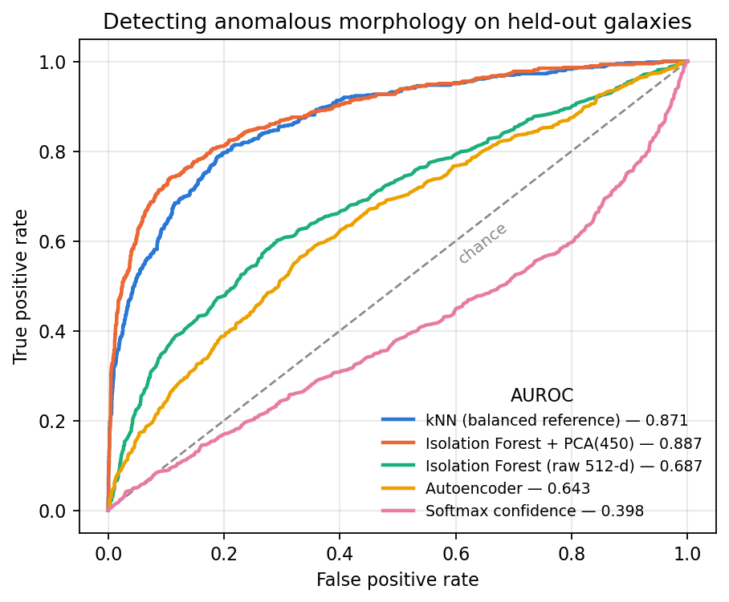

# GALAD — Galaxy Anomaly Detection

Finding morphologically unusual galaxies in survey imagery, and a careful account of
how well that actually works.

A ResNet-18 fine-tuned on Galaxy10 DECaLS reaches **78.3%** accuracy over ten
morphology classes. Using its feature space, kNN and Isolation Forest both detect
disturbed and merging galaxies at **AUROC ≈ 0.886** on held-out data, while a
pixel-level autoencoder (0.643) and a softmax-confidence baseline (0.398) do not
work. A control experiment shows that **all** of the detection signal comes from
supervised fine-tuning: a plain ImageNet backbone scores at chance.

📄 **[Read the full report →](REPORT.md)**



---

## Results at a glance

| Method | AUROC | Average precision |
|---|---|---|
| Isolation Forest + PCA(450) | **0.8857 ± 0.0012** | **0.7021 ± 0.0068** |
| kNN (balanced reference set) | 0.8782 ± 0.0045 | 0.6791 ± 0.0112 |
| Isolation Forest, raw 512-d | 0.6916 ± 0.0169 | 0.3332 ± 0.0377 |
| Autoencoder (bottleneck 8) | 0.6434 | 0.2864 |
| Softmax confidence | 0.3979 | 0.1437 |
| *Random detector* | *0.5000* | *0.1654* |

Evaluated on 3,548 held-out galaxies (2,961 normal + 587 anomalous) at the dataset's
real 16.5% anomaly rate. Average precision is reported alongside AUROC because AUROC
is insensitive to class prevalence and flatters rare-event detectors.

**Two findings matter more than the ranking above:**

1. **Reference-set composition swings AUROC by 0.385.** A reference set drawn in
   dataset order contains only two of the eight normal classes and collapses to
   chance (0.493); a class-balanced one reaches 0.878. That single sampling decision
   outweighs every algorithmic choice in the project combined.
2. **The method is semi-supervised, not unsupervised.** Under an identical protocol,
   a non-fine-tuned ImageNet ResNet-18 scores 0.482 — chance. The detector depends on
   labels for the very classes it "discovers", which limits it to scaling a known
   anomaly category rather than finding unknown ones.

---

## Repository layout

```
src/
  common.py            paths, the anomaly definition, and THE data split
  detectors.py         the four detectors + reference-set constructions
  dataset.py           Dataset wrapper
  train_classifier.py  fine-tune ResNet-18
  train_autoencoder.py train the autoencoder on train-split normals
  autoencoder.py       architecture

scripts/
  check_data.py        print dataset composition and the exact split
  score_autoencoder.py per-image reconstruction error

evaluation/
  extract_features.py  512-d features + logits, per backbone
  evaluate.py          every number in the report -> docs/results.json
  figures.py           every figure in the report -> figures/

demo/app.py            Gradio demo
docs/results.json      machine-readable results
```

The data split is defined **once**, in `src/common.py`, and imported everywhere. That
is deliberate: the classifier doubles as the feature extractor for the anomaly
detectors, so if they evaluated on a different split, their evaluation images would
be ones whose feature vectors had already been optimised with knowledge of their
labels.

---

## Setup

```bash
git clone <this repo>
cd GALAD
pip install -r requirements.txt
```

**Dataset.** Download `Galaxy10 DECaLS.h5` (~2.5 GB) from
[astroNN](https://astronn.readthedocs.io/en/latest/galaxy10.html) and place it in
`data/`. It is gitignored.

**Checkpoints.** `models/*.pth` are gitignored (~45 MB each). Either train them:

```bash
python src/train_classifier.py    # -> models/classifier.pth
python src/train_autoencoder.py   # -> models/autoencoder_b8.pth
python scripts/score_autoencoder.py   # -> data/ae_scores.npy
```

Scripts have no command-line flags; settings are constants at the top of each file.
To produce `models/classifier_noaug.pth`, set `AUGMENT = False` in
`src/train_classifier.py` and rerun it.

Training the classifier takes roughly 40 minutes on an M-series Mac, the autoencoder
about the same.

---

## Reproducing the report

```bash
python scripts/check_data.py            # dataset composition and the split
python evaluation/extract_features.py   # ~17 min on an M-series Mac, all 4 backbones
python evaluation/evaluate.py           # every table -> docs/results.json
python evaluation/figures.py            # every figure -> figures/
```

`extract_features.py` caches to `data/feat_*.npz` and skips backbones already done;
delete those files to recompute. Every table in [REPORT.md](REPORT.md) is generated by
`evaluate.py`; nothing in the report is hand-transcribed.

Run the demo with:

```bash
python demo/app.py
```

---

## Evaluation protocol

Stated explicitly because it determines every number in the report:

| | |
|---|---|
| Split | 80/20, stratified over all ten classes, `random_state=42` |
| Fitted on | normal galaxies (classes 2–9) from the **train** split only |
| Evaluated on | the **entire test split**, 2,961 normal + 587 anomalous |
| Positive class | anomalous (classes 0–1: Disturbed, Merging) |
| Metrics | AUROC and average precision |
| Variance | 5 seeds for every subsampling method; mean ± sd |

The classifier doubles as the feature extractor for kNN and Isolation Forest, so the
detectors must share its split — otherwise the evaluation images were ones whose
feature vectors had been optimised with knowledge of their labels.

---

## Dataset

[Galaxy10 DECaLS](https://astronn.readthedocs.io/en/latest/galaxy10.html): 17,736
colour images (256×256, g/r/z bands) from the DESI Legacy Imaging Surveys, labelled
into ten morphology classes from Galaxy Zoo volunteer classifications. Classes 0
(Disturbed, 1,081) and 1 (Merging, 1,853) are treated as anomalous; classes 2–9
(14,802 images) as normal.

Note that the HDF5 file is **sorted by class**, so taking "the first N images" gives
a class-sorted sample rather than a random one. [REPORT.md §4.3](REPORT.md) shows
what that does to a detector built on top of it.

---

## Scope

Read [REPORT.md §7](REPORT.md) before using this on anything real. In short: the
method needs labels for the anomalies it detects, it detects mergers well and
disturbed galaxies poorly, and nothing here tests transfer across instruments.

---

## Acknowledgements

Galaxy10 DECaLS by Leung & Bovy, built on DESI Legacy Imaging Surveys data and Galaxy
Zoo classifications. ResNet-18 from torchvision with ImageNet weights.
