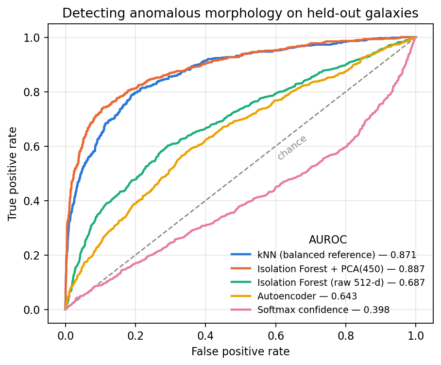
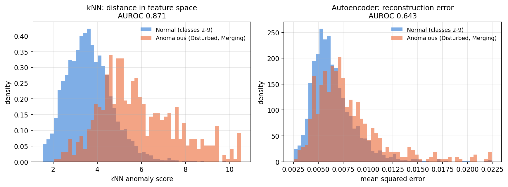
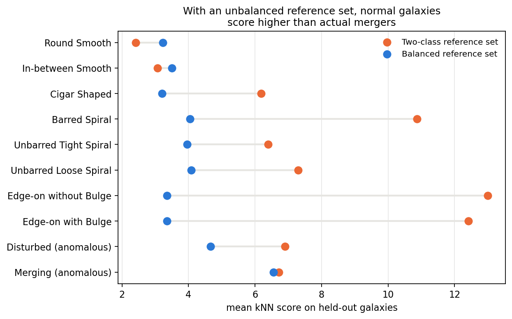
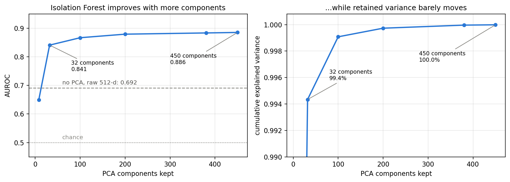
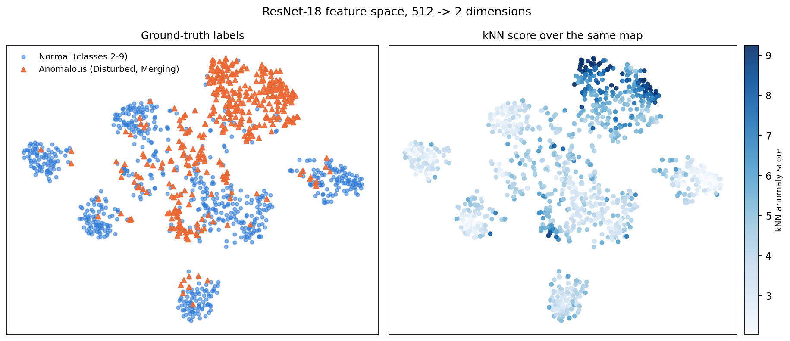
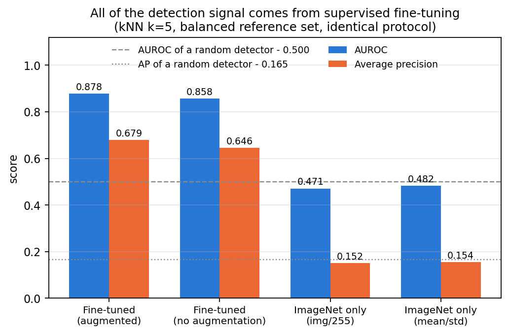
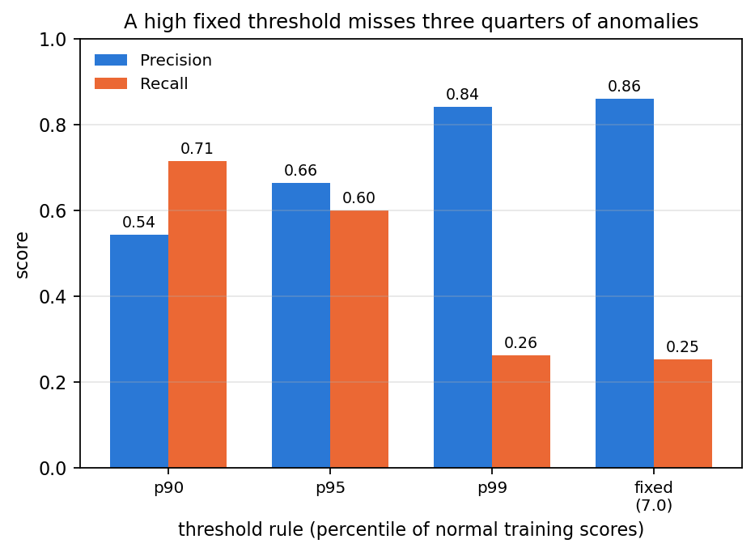

# Anomaly Detection in Astronomical Images Using Deep Learning

**Yersaiyn Maratov** — ACSAI, Sapienza University of Rome

---

## Abstract

Large astronomical surveys produce more imaging data than astronomers can inspect
manually, which makes automated triage of morphologically unusual galaxies a
practical necessity. This report compares four approaches to flagging anomalous
galaxies in Galaxy10 DECaLS: a convolutional autoencoder, k-nearest neighbours in a
learned feature space, Isolation Forest after PCA reduction, and a softmax-confidence
baseline. A ResNet-18 classifier fine-tuned on the ten morphology classes reaches
**78.3%** accuracy on held-out data. Evaluated on the same held-out split, kNN
(AUROC **0.878**) and Isolation Forest with PCA (AUROC **0.886**) perform
comparably, while the autoencoder (0.643) is far behind and
softmax confidence (0.398) is *worse* than chance. Two results dominate. First, the
composition of the reference set matters far more than the choice of scoring
algorithm: a reference set drawn in dataset order contains only two of the eight
normal classes and collapses to chance (0.493), while a class-balanced one reaches
0.878 — a swing of 0.385 AUROC from a sampling decision. Second, a control
experiment shows that an ImageNet ResNet-18 that was never fine-tuned scores at
chance (0.482) under the identical protocol. All of the detection signal therefore
comes from supervised fine-tuning on labels that include the two classes being
"discovered". This is a semi-supervised detector, and reporting it as unsupervised
anomaly detection would overstate what it does.

**Keywords:** anomaly detection, galaxy morphology, transfer learning, kNN,
Isolation Forest, evaluation methodology

---

## 1. Introduction

Current and upcoming surveys — the DESI Legacy Imaging Surveys among them — produce
galaxy images faster than any team can review them. Objects with unusual morphology
(mergers, tidal disruptions, other irregularities) are scientifically interesting
precisely because they fall outside standard classification schemes, so finding them
efficiently matters.

Citizen-science projects such as Galaxy Zoo addressed this through crowdsourced
classification, but the approach does not scale with data volume. Machine learning
has shown promise: the Astronomaly framework [2] combines unsupervised learning with
active learning to surface unusual objects, and Paz [4] used an ML pipeline to
identify 1.5 million previously unknown variable objects in NEOWISE archival data.

This project asks a narrower, more tractable question. Given a labelled dataset of
galaxy images, how well do different anomaly-scoring methods separate normal
morphologies from irregular ones, and what kind of information — pixel-level or
structural — does each one actually use? A second question turned out to matter more
than the first: **how much of the measured performance is a property of the method,
and how much is a property of the evaluation setup?**

---

## 2. Data

Galaxy10 DECaLS [5] contains 17,736 colour images (256×256, three channels from the
g, r, z bands) from the DESI Legacy Imaging Surveys, labelled into ten morphology
classes derived from Galaxy Zoo volunteer classifications.

| Class | Name | Total | Train | Test | Role |
|---|---|---|---|---|---|
| 0 | Disturbed Galaxies | 1,081 | 865 | 216 | **anomalous** |
| 1 | Merging Galaxies | 1,853 | 1,482 | 371 | **anomalous** |
| 2 | Round Smooth Galaxies | 2,645 | 2,116 | 529 | normal |
| 3 | In-between Round Smooth | 2,027 | 1,622 | 405 | normal |
| 4 | Cigar Shaped Smooth | 334 | 267 | 67 | normal |
| 5 | Barred Spiral Galaxies | 2,043 | 1,634 | 409 | normal |
| 6 | Unbarred Tight Spiral | 1,829 | 1,463 | 366 | normal |
| 7 | Unbarred Loose Spiral | 2,628 | 2,102 | 526 | normal |
| 8 | Edge-on without Bulge | 1,423 | 1,139 | 284 | normal |
| 9 | Edge-on with Bulge | 1,873 | 1,498 | 375 | normal |

The dataset is imbalanced: Cigar Shaped has 334 images, Round Smooth 2,645. That
imbalance is not a cosmetic detail — §4.3 shows it is the single largest factor in
detector performance.

Classes 0 and 1 are designated anomalous and classes 2–9 normal, giving 14,802 normal
and 2,934 anomalous images. Disturbed and merging galaxies exhibit irregular
morphologies that deviate from standard classification schemes, which makes them a
reasonable stand-in for "the thing we want a survey triage tool to surface".

One property of the file matters later: the images are **ordered by class**. Taking
"the first N images" therefore yields a class-sorted sample rather than a random one.
§4.3 shows what that does to a detector.

---

## 3. Method

### 3.1 Evaluation protocol

This section comes first because every number in this report depends on it, and
because the single easiest way to overstate an anomaly detector is to be careless
here.

| | |
|---|---|
| Split | 80/20, stratified over all ten classes, `random_state=42` |
| | train 14,188 · test 3,548 |
| Fitted on | normal galaxies from the **train** split only (11,841) |
| Evaluated on | the **entire test split**: 2,961 normal + 587 anomalous |
| Positive class | anomalous |
| Metrics | AUROC and average precision (AP) |
| Random baseline | AUROC 0.500, **AP 0.165** |
| Variance | every subsampling method is run over 5 seeds; mean ± sd reported |

Three properties are deliberate:

**One split for everything.** The classifier is trained on the train split, and the
anomaly detectors fit on normal galaxies from that same train split and are evaluated
on the test split. Because the detectors use the classifier as their feature
extractor, any other arrangement leaks: if the evaluation images were in the
classifier's training set, their feature vectors were optimised with knowledge of
their labels. The split lives in one place, `src/common.py`, and every script
imports it.

**One evaluation set for every method.** Feature-space methods, the autoencoder and
the confidence baseline are all scored on the same 3,548 images, so the comparison in
Table 2 is like-for-like.

**The real anomaly rate.** The test split carries the dataset's natural 16.5%
anomaly prevalence rather than an artificially balanced 50/50 sample. AUROC is
insensitive to prevalence and flatters rare-event detectors; average precision is
not, which is why both are reported. A detector at AUROC 0.89 sounds strong until
you see it corresponds to AP 0.70 against a 0.165 floor.

### 3.2 Galaxy classifier

A ResNet-18 pre-trained on ImageNet, fine-tuned for ten-class morphology
classification. The final fully connected layer is replaced with a 512→10 linear
layer. **All layers are trained** — nothing is frozen.

- Optimizer: Adam, lr = 1e-3 · Loss: cross-entropy · Batch size: 32 · Epochs: 10
- Augmentation: random horizontal flip, vertical flip, rotation (±30°)
- Preprocessing: images scaled to [0,1]. ImageNet mean/std normalisation is **not**
  applied (see §7).

Augmentation is the difference between a model that memorises and one that
generalises:

| | Train accuracy | Test accuracy | Gap |
|---|---|---|---|
| No augmentation | 94.8% | 73.5% | 21.3 pts |
| With augmentation | 81.5% | **78.3%** | 3.2 pts |

Both checkpoints are kept. The un-augmented one is used in §5 to check whether the
detection results depend on which classifier supplies the feature space.

### 3.3 Autoencoder

A convolutional autoencoder trained only on the 11,841 normal galaxies of the train
split, scoring each image by its reconstruction error. Training on normal data alone
is the premise: the model should reconstruct ordinary morphologies well and unusual
ones badly.

- **Encoder:** three stride-2 convolutions (3→32→64→128), 256×256 → 32×32, then a
  fully connected bottleneck.
- **Decoder:** fully connected expansion, then three transposed convolutions
  (128→64→32→3) back to 256×256.
- Adam lr = 1e-3, MSE loss, batch 32, 10 epochs.
- Anomaly score = mean squared error between input and reconstruction.

The bottleneck is set to 8. §4.2 explains why its exact size is not the interesting
variable: what limits this detector is what MSE rewards, not how tightly the latent
space is squeezed.

### 3.4 kNN in feature space

The classifier's final layer is removed, yielding 512-dimensional feature vectors.
A `NearestNeighbors` model is fitted on a reference set of normal training galaxies;
an image's anomaly score is the mean distance to its *k* nearest normal neighbours.

`k` is fixed at 5 and was not tuned, so no claim is made that it is optimal. The
choice that *is* swept here is the one that turns out to dominate everything else:
the composition of the reference set (§4.3).

### 3.5 Isolation Forest with PCA

Isolation Forest [6] isolates points by recursive random partitioning: anomalies need
fewer splits because they are sparse. Applied to the same ResNet-18 features, with
`n_estimators=200`, `contamination=0.1`.

Applied to raw 512-dimensional features it reaches only AUROC 0.692. PCA before
fitting raises this to 0.886. §4.5 explains why, and why the usual "it retains 99% of
the variance" explanation is wrong.

### 3.6 Confidence baseline

The maximum softmax probability, inverted (`1 − max p`), used as an anomaly score.
Included to demonstrate a limitation rather than to compete — and it demonstrates a
sharper one than expected (§4.4).

---

## 4. Results

### 4.1 Classification

ResNet-18 with augmentation, **test split only**:

| Class | Precision | Recall | F1 | Support |
|---|---|---|---|---|
| Disturbed | 0.53 | 0.41 | 0.46 | 216 |
| Merging | 0.61 | 0.98 | 0.75 | 371 |
| Round Smooth | 0.92 | 0.88 | 0.90 | 529 |
| In-between Smooth | 0.94 | 0.72 | 0.81 | 405 |
| Cigar Shaped | 0.58 | 0.85 | 0.69 | 67 |
| Barred Spiral | 0.89 | 0.81 | 0.85 | 409 |
| Unbarred Tight Spiral | 0.80 | 0.54 | 0.65 | 366 |
| Unbarred Loose Spiral | 0.65 | 0.71 | 0.68 | 526 |
| Edge-on without Bulge | 0.91 | 0.92 | 0.91 | 284 |
| Edge-on with Bulge | 0.91 | 0.93 | 0.92 | 375 |
| **Accuracy** | | | **0.78** | **3,548** |
| Macro average | 0.77 | 0.78 | 0.76 | 3,548 |

ImageNet pre-training transfers usefully to galaxy morphology despite the enormous
domain gap. Two per-class observations:

- **Cigar Shaped** reaches recall 0.85 from only 267 training examples — its
  elongated profile is distinctive enough to survive extreme class imbalance.
- **Merging** shows recall 0.98 against precision 0.61: the model sweeps almost
  everything ambiguous into this class. This becomes important in §4.4.
- **Disturbed** is the hardest class (F1 0.46). Its irregularity is exactly what
  makes it hard to classify — and, as §4.3 shows, also hard to detect.

### 4.2 Anomaly detection



*Figure 1 — ROC curves on the 3,548 held-out galaxies. Legend values come from a
single reference draw (seed 0); Table 2 reports means over five seeds, which is why
the kNN figure there is slightly higher.*

**Table 2 — Detection performance (augmented backbone, held-out test split)**

| Method | AUROC | AP |
|---|---|---|
| Isolation Forest + PCA(450) | **0.8857 ± 0.0012** | **0.7021 ± 0.0068** |
| Isolation Forest + PCA(380) | 0.8839 ± 0.0012 | 0.6974 |
| kNN, balanced reference | 0.8782 ± 0.0045 | 0.6791 ± 0.0112 |
| kNN, all 11,841 normal train galaxies | 0.8655 | 0.6523 |
| Isolation Forest, raw 512-d | 0.6916 ± 0.0169 | 0.3332 ± 0.0377 |
| Autoencoder (bottleneck 8) | 0.6434 | 0.2864 |
| Softmax confidence | 0.3979 | 0.1437 |
| *Random detector* | *0.5000* | *0.1654* |
| kNN, dataset-order reference | 0.4926 | 0.1465 |



*Figure 2 — Why the feature-space method works and the pixel-level one does not.
kNN distances separate into two distinguishable distributions; autoencoder
reconstruction errors overlap almost entirely.*

Three things follow.

**Feature-space methods beat pixel-level ones decisively** — 0.89 against 0.64. The
autoencoder compares images pixel by pixel, and disturbed galaxies share most
low-level properties with normal ones: similar brightness ranges, colour
distributions and angular sizes. The irregularities are structural, and MSE does not
isolate them. In practice reconstruction error tracks brightness and galaxy size more
closely than anomaly status.

MSE is also dominated by bright pixels, so the latent space spends its capacity on
luminosity before it spends any on structure. That is a property of the loss rather
than of the latent size, which suggests the thing to change is not the bottleneck but
the objective — a loss defined on features rather than on pixels.

**The scoring algorithm barely matters once the feature space is fixed.** kNN and
Isolation Forest differ by 0.008 AUROC — about the size of the spread from re-drawing
the reference set (±0.005 for kNN). Distance-to-neighbours and ease-of-isolation are
measuring the same geometry. **What matters is the representation, not the
estimator** — a conclusion §5 then qualifies sharply.

**Average precision is the sobering number.** AUROC 0.89 corresponds to AP 0.70
against a 0.165 floor. The detector is genuinely useful for triage but is nowhere
near a solved problem at realistic anomaly rates.

### 4.3 The reference set dominates everything



*Figure 3 — Mean kNN anomaly score per class on held-out galaxies, under two
reference sets. With the dataset-order reference set, Edge-on galaxies — which are
perfectly normal — score higher than actual mergers.*

Because the HDF5 file is sorted by class, taking the first 3,000 normal feature
vectors yields a reference set of Round Smooth (2,116) and In-between Smooth (884)
and **nothing else**. Six of the eight normal classes are absent. The detector is
then not measuring "distance from normal galaxies" but "distance from round smooth
galaxies", and it ranks Edge-on morphologies (score 12–13) as more anomalous than
Disturbed (6.9) and Merging (6.7).

| Reference set | n | AUROC | AP |
|---|---|---|---|
| Dataset order, first 3,000 (two classes only) | 3,000 | **0.4926** | 0.1465 |
| Class-balanced, 267 per class, random | 2,136 | **0.8782 ± 0.0045** | 0.6791 |
| All normal train galaxies | 11,841 | 0.8655 | 0.6523 |

**A sampling decision is worth 0.385 AUROC here — more than the gap between every
method in Table 2 combined.** A balanced reference set of 2,136 galaxies also beats
using all 11,841, because the full pool inherits the dataset's class imbalance.

The per-class scores also show where the remaining errors live:

| Class | Balanced reference | | Class | Balanced reference |
|---|---|---|---|---|
| Round Smooth | 3.23 | | Unbarred Loose Spiral | 4.08 |
| In-between Smooth | 3.51 | | Edge-on without Bulge | 3.35 |
| Cigar Shaped | 3.21 | | Edge-on with Bulge | 3.35 |
| Barred Spiral | 4.05 | | **Disturbed** *(anomalous)* | **4.66** |
| Unbarred Tight Spiral | 3.95 | | **Merging** *(anomalous)* | **6.55** |

Merging separates cleanly (6.55 against a normal range of 3.2–4.1). **Disturbed does
not** — at 4.66 it overlaps Barred Spiral (4.05) and Unbarred Loose Spiral (4.08).
The detector is substantially a merger detector; the headline AUROC averages over a
class it handles well and a class it handles poorly.

### 4.4 Softmax confidence is worse than useless

| Backbone | AUROC | AP | Mean confidence, normal | Mean confidence, anomalous |
|---|---|---|---|---|
| Augmented | **0.3979** | 0.1437 | 0.840 | **0.872** |
| No augmentation | 0.6552 | 0.2546 | 0.892 | 0.816 |

The augmented classifier is, on average, **more** confident on anomalous galaxies
than on normal ones, so inverted confidence ranks them backwards and lands below
chance.

The usual explanation — softmax overconfidence on out-of-distribution inputs — does
not apply, and this is the point. The classifier was trained on all ten classes,
including both "anomalous" ones. Disturbed and Merging are not out-of-distribution
for it; they have dedicated output neurons. Combined with the Merging recall of 0.98
at precision 0.61 from §4.1, the mechanism is clear: the model confidently routes
anything irregular into Merging. Low confidence cannot signal an anomaly when the
network has been explicitly taught to name it.

A classifier trained only on classes 2–9 would be a genuine OOD setup and would
behave differently. That experiment is not run here.

### 4.5 Why Isolation Forest needs PCA — and it is not about variance



*Figure 4 — AUROC climbs steeply with the number of retained components while
cumulative explained variance is essentially saturated throughout.*

| Components | 8 | 32 | 100 | 200 | 380 | **450** | none |
|---|---|---|---|---|---|---|---|
| AUROC | 0.650 | 0.841 | 0.867 | 0.880 | 0.884 | **0.886** | 0.692 |
| Cum. variance | 0.932 | 0.994 | 0.999 | 1.000 | 1.000 | 1.000 | — |

The intuitive explanation — "PCA keeps ~99% of the variance, so the signal is
preserved" — is numerically vacuous. PCA(32) already retains **99.4%** of the
variance and scores 0.841; PCA(450) retains 100.0% and scores 0.886. Variance moves
by 0.6 percentage points while AUROC moves by 0.045. Retained variance cannot be the
explanatory variable.

The actual mechanism is in how scikit-learn builds the forest. `IsolationForest`
constructs its trees from `ExtraTreeRegressor(max_features=1, splitter="random")`:
**each split cuts on a single randomly chosen axis at a random threshold.** On raw,
highly correlated ResNet features, an axis-aligned cut carries almost no information
about whether a point is unusual, so path lengths converge for everything and the
score degenerates (0.692). PCA rotates the data onto decorrelated axes ordered by
variance, which is precisely the condition under which single-axis random cuts become
informative. It is a statement about the *orientation* of the basis, not about how
much variance survives.

Note also that AUROC plateaus rather than peaking: everything from 200 components
upward sits inside a ±0.003 band, so there is no meaningful "optimal" setting to
report. Anything above roughly 200 components works.

### 4.6 Feature space structure



*Figure 5 — t-SNE of the 512-d feature space for 1,100 held-out galaxies. Left:
ground-truth labels. Right: the kNN anomaly score over the same embedding.*

The left panel shows anomalous galaxies concentrated in an upper region distinct
from the normal clusters, which is what both kNN and Isolation Forest exploit. The
right panel shows the score reproducing that structure — and also where it fails:
the anomalous points scattered through the centre-bottom of the map receive
mid-range scores and are the recall losses behind §4.3.

---

## 5. What the method actually learned

Everything above was measured with a backbone fine-tuned on all ten classes,
including the two labelled anomalous. To isolate how much of the performance comes
from the representation being *learned* versus being *supervised with the answer*,
the identical protocol was run on a plain ImageNet ResNet-18 with no fine-tuning.



*Figure 6 — kNN with a balanced reference set under the identical protocol, by
backbone.*

| Backbone | AUROC | AP |
|---|---|---|
| Fine-tuned, augmented | 0.8782 | 0.6791 |
| Fine-tuned, no augmentation | 0.8578 | 0.6458 |
| ImageNet only, project preprocessing | 0.4712 | 0.1516 |
| ImageNet only, correct mean/std normalisation | 0.4819 | 0.1542 |
| *Random* | *0.5000* | *0.1654* |

**Without fine-tuning the method sits at chance.** The control was run in two
preprocessing variants specifically so the result cannot be dismissed as an artefact
of this project's `img/255`-only pipeline — proper ImageNet normalisation changes
nothing.

This reframes the headline conclusion. It is not that "a learned feature space beats
pixel-level methods"; generic learned features carry no usable signal here. It is
that **a feature space trained with labels for the very classes being detected beats
pixel-level methods**. The detector is semi-supervised: the scoring step is
unsupervised, but it operates on a representation that is not.

The practical consequence is a scope limit. For the motivating use case — finding
*unknown* anomalies in a survey — those labels do not exist by definition, and this
pipeline in its current form does not transfer to that setting. What it does support
is scaling a known, labelled anomaly category to a large unlabelled archive.

---

## 6. Operating point

A detector needs a threshold, and the threshold must not be chosen on the evaluation
data. Here it is calibrated on a held-out 10% slice of the normal training galaxies.



| Rule | Threshold | Precision | Recall | F1 | Flagged |
|---|---|---|---|---|---|
| 90th percentile of normal train | 4.95 | 0.543 | 0.714 | 0.617 | 771 / 3,548 |
| **95th percentile** | **5.44** | **0.663** | **0.600** | **0.630** | 531 / 3,548 |
| 99th percentile | 6.91 | 0.842 | 0.262 | 0.400 | 183 / 3,548 |
| *A fixed, high threshold of 7.0* | *7.00* | *0.860* | *0.252* | *0.390* | *172 / 3,548* |

The p95 rule gives the best F1 and is what `demo/app.py` uses. The last row is a
caution: a threshold chosen to look precise buys 0.86 precision at the cost of
missing three quarters of all anomalies, which for survey triage is the wrong trade.
It is also the kind of value that is tempting to read straight off the test
distribution — which would fit the threshold to the evaluation set and make the
reported precision meaningless.

---

## 7. Conclusions

**On the methods.** Operating in a learned feature space beats pixel-level
reconstruction for morphological anomaly detection — 0.886 against 0.643 AUROC. Once
the feature space is fixed, the scoring algorithm is nearly irrelevant: kNN and
Isolation Forest land within 0.008 of each other, inside the spread from
re-drawing the reference set. Pixel-wise MSE is a poor proxy for
morphological anomaly when normal and anomalous objects share brightness and scale
characteristics, because the loss rewards reproducing brightness before structure.

**On the data handling, which mattered more.** The composition of the reference set
swung AUROC by 0.385 — an order of magnitude more than any algorithmic choice in this
report. Class-balanced sampling of a modest 2,136 galaxies beats using all 11,841.
The failure mode is instructive: a reference set that silently contained two of eight
normal classes produced a detector that ranked edge-on spirals above merging
galaxies, and still would have looked plausible had only a single aggregate metric
been reported.

**On what the detector is.** The ImageNet control settles it: without supervised
fine-tuning on labels that include the anomaly classes, performance is at chance.
This is a semi-supervised detector for a known anomaly category, not a discovery tool
for unknown ones.

**On evaluation.** Two choices did more for the trustworthiness of these numbers
than any modelling decision. The first is defining the split once, in code, and
sharing it between the classifier and the detectors that use it as a feature
extractor — otherwise the evaluation images are ones whose feature vectors were
optimised with knowledge of their labels, and the result is inflated in a way no
amount of care elsewhere will reveal. The second is reporting average precision next
to AUROC: at a 16.5% anomaly rate, AUROC 0.89 and AP 0.70 describe the same detector,
and only one of them sounds like a solved problem.

**Where this applies, and where it does not.** The detector works on one survey,
one instrument and one definition of "anomalous" — Disturbed or Merging as judged by
Galaxy Zoo volunteers, which is a label-derived stand-in for scientific interest
rather than the thing itself. Within that scope it is useful for triage, with the
caveat from §4.3 that it is substantially a merger detector: Merging separates
cleanly, Disturbed overlaps the normal spirals. Outside that scope two things would
have to be checked before trusting it. Transfer across instruments is untested here
and is the first thing a real survey-triage tool would have to survive. And because
the feature space is supervised, applying this to genuinely unknown anomalies is not
a matter of pointing it at new data — there would be no labels to build the space
from. One implementation detail is worth stating for anyone reproducing this: the
ImageNet-pretrained backbone is fed `img/255` without mean/std normalisation, which
is how the released checkpoints were trained; §5 shows the control is unaffected by
it, but changing it would require retraining.

**Future work.** Train on the full Galaxy Zoo corpus (441,000+ images) rather than
this 17,736-image subset; replace MSE in the autoencoder with a perceptual loss
operating on features rather than pixels; train a classifier that excludes the
anomaly classes so the confidence baseline becomes a genuine OOD test; and test
transfer across instruments.

---

## 8. Reproducing these numbers

```bash
pip install -r requirements.txt
# place Galaxy10 DECaLS.h5 in data/  (see README)

python scripts/check_data.py            # dataset composition and the split
python src/train_classifier.py          # or use the released checkpoints
python evaluation/extract_features.py   # 512-d features for all four backbones
python evaluation/evaluate.py           # every number above -> docs/results.json
python evaluation/figures.py            # every figure above -> figures/
```

Every table in this report is generated by `evaluation/evaluate.py` and stored in
[`docs/results.json`](docs/results.json).

---

## References

1. He, K., Zhang, X., Ren, S. & Sun, J. (2016). "Deep residual learning for image
   recognition." *CVPR.*
2. Lochner, M. & Bassett, B. A. (2021). "Astronomaly: at the intersection of
   unsupervised and active anomaly detection in astronomical data." *Astronomy and
   Computing.*
3. Leung, H. W. & Bovy, J. (2019). "Deep learning of multi-element abundances from
   high-resolution spectroscopic data." *MNRAS.*
4. Paz, M. (2024). "VarWISE: Machine Learning Classification of Variable Objects in
   NEOWISE Data." *The Astronomical Journal.*
5. Galaxy10 DECaLS dataset. https://astronn.readthedocs.io/en/latest/galaxy10.html
6. Liu, F. T., Ting, K. M. & Zhou, Z.-H. (2008). "Isolation Forest." *ICDM.*
